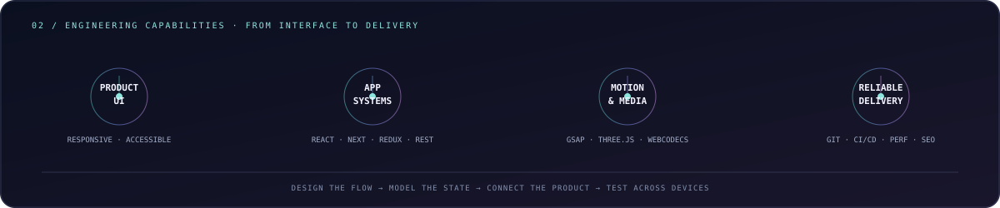
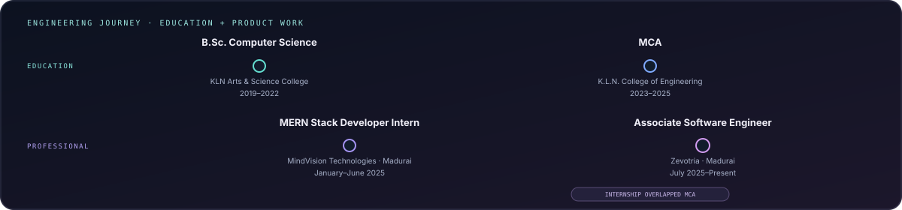

**Frontend Software Engineer · React.js · Next.js · JavaScript**  
**1.5+ years building for the web** · Madurai, India

[Portfolio](https://bhogyaan.vercel.app) &nbsp;·&nbsp; [LinkedIn](https://linkedin.com/in/bhogyaannr) &nbsp;·&nbsp; [Email](mailto:bhogyaannr@gmail.com) &nbsp;·&nbsp; [GitHub](https://github.com/Bhogyaan)

## About

I turn pixels into products—and product requirements into interfaces that make sense. At **Zevotria**, I build frontend experiences across commerce, career tools, 3D previs, and browser-based media. I care about the whole path: a reusable component, the state behind it, the API it talks to, and how it behaves on an actual phone.

Making interfaces behave since day one. The occasional CSS negotiation is part of the process.

## What I build

**Product experiences** — Responsive websites and applications, SaaS workflows, dashboards, reusable components, and browser extensions.  
**Frontend engineering** — React, Next.js, JavaScript, Redux Toolkit, REST API integration, and application state.  
**Interaction** — GSAP, Framer Motion, Lenis, custom SVG, Three.js, and React Three Fiber.  
**Ship with care** — Performance, SEO, cross-device UI, Git workflows, CI/CD, GitHub Actions, and deployment with Vercel, Netlify, or AWS.

## Tech ecosystem

`Frontend` React · Next.js · JavaScript (ES6+) · TypeScript · HTML · CSS · Tailwind CSS · Vite  
`State & APIs` Redux Toolkit · REST APIs · Axios · application state  
`Motion & media` GSAP · Framer Motion · Lenis · Three.js · React Three Fiber · WebCodecs · Mediabunny · FFmpeg.wasm · Canvas · Web Audio  
`Full stack & delivery` Node.js · Express · MongoDB · MySQL · Git · GitHub Actions · CI/CD · Vercel · Netlify · AWS

## Selected product work

These are products associated with my work at **Zevotria**. Product context below describes the platforms—not sole ownership of every feature. Public project links aren’t available in this profile, so I’ve kept the links to my portfolio and contact details rather than guessing URLs.

| Product | What it is | Frontend context |
| --- | --- | --- |
| **Kellygang.ai** | AI-powered creative platform and wedding studio; the existing profile describes a React Native / Expo app, with VOWS Studio as a creative experience within it. | React Native · Expo · modular UI |
| **CareerPro AI** | Career development platform with resume editing, preview and export, plus mock-interview workflows with response capture and speech transcription. | React · JavaScript · state · API integration |
| **ETradeHub** | B2B marketplace. | Frontend product engineering |
| **OYIL Luxe** | Premium shopping in the OYIL commerce ecosystem, alongside OYIL Attires and OYIL Admin CMS. The ecosystem includes product, inventory, customer, order, and rental management. | React · Vite · JavaScript · APIs |

**Also in the mix:** 3D previs and staging with Three.js / React Three Fiber, and a browser-based video-editing experience using WebCodecs and browser media APIs.

## Engineering journey

**Associate Software Engineer · Zevotria** — *July 2025–Present · Madurai*  
Building frontend product experiences with React and related tools; collaborating on product development and supporting other engineers.

**MERN Stack Developer Intern · MindVision Technologies** — *January–June 2025 · Madurai*  
Built React pages and reusable UI components, connecting frontend features to backend APIs.

**Education** — MCA, K.L.N. College of Engineering *(2023–2025)* · B.Sc. Computer Science, KLN Arts and Science College *(2019–2022)*. The MCA and internship dates overlap.

## GitHub activity

The contribution calendar is GitHub’s own, shown on my profile above this README. These account-data cards are refreshed by the existing repository workflows—no hand-entered counts or invented streaks.

## Connect

Interested in frontend product engineering, interactive interfaces, or 3D and browser-media experiences? [Explore my portfolio](https://bhogyaan.vercel.app), [connect on LinkedIn](https://linkedin.com/in/bhogyaannr), or [email me](mailto:bhogyaannr@gmail.com).

Less div chaos. More design systems. Still, the divs have their moments.

