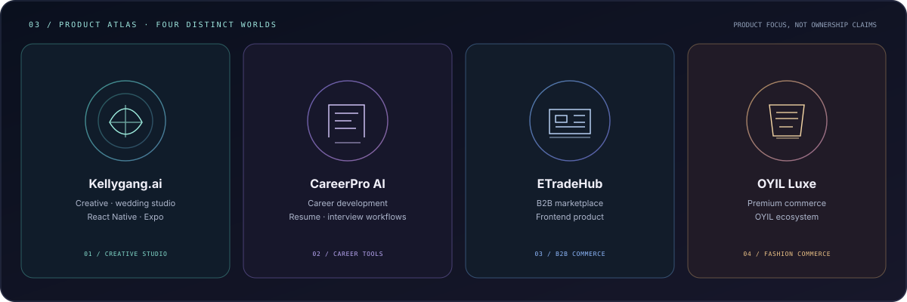
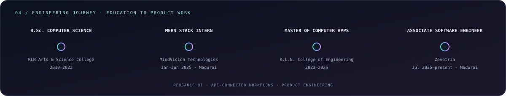
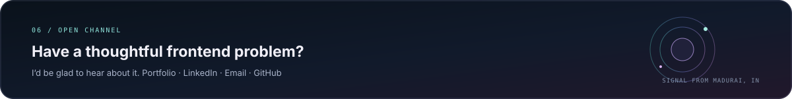

**Frontend Software Engineer · React.js · Next.js · JavaScript**  
**1.5+ years building for the web** · Madurai, India

[Portfolio](https://bhogyaan.vercel.app) &nbsp;·&nbsp; [LinkedIn](https://linkedin.com/in/bhogyaannr) &nbsp;·&nbsp; [Email](mailto:bhogyaannr@gmail.com) &nbsp;·&nbsp; [GitHub](https://github.com/Bhogyaan)

I like the part where a polished interface meets a complicated product problem. I build responsive React experiences, connect them to real application workflows, and care about the details between “it renders” and “it feels right.”

Currently an **Associate Software Engineer at Zevotria**, working across product UI, 3D previs, commerce, career tools, and browser-based media. Based in Madurai; usually somewhere between a component boundary and a browser devtools tab.

> Small joke from the bug tracker: “It works on my machine” is a useful first observation—not a deployment strategy.

---

## `01 — FIELD NOTES FROM THE FRONTEND`

A working toolkit, not a badge collection. The technologies below reflect my profile and the products I work on.

| Product interface | Application systems | Motion & media | Shipping & quality |
| --- | --- | --- | --- |
| React · Next.js · JavaScript · TypeScript · HTML · CSS · Tailwind · Vite | Redux Toolkit · REST APIs · state management · Node.js · Express · MongoDB · MySQL | GSAP · Framer Motion · Lenis · Three.js · React Three Fiber · WebCodecs · Mediabunny · Canvas · Web Audio | Git · branching & merging · GitHub Actions · CI/CD · Vercel · Netlify · AWS · performance · SEO · responsive / cross-device UI · browser extensions |

## `02 — WHAT I BUILD`

**Product UI** — Responsive interfaces, reusable components, custom SVGs, and careful interaction design.  
**Frontend systems** — React and Next.js application structure, state management, REST integration, and SaaS workflows.  
**Motion & real-time experiences** — GSAP, Framer Motion, Lenis, Three.js, and browser media APIs.  
**Reliable delivery** — Performance and SEO considerations, cross-device testing, Git workflows, and CI/CD deployment paths.

## `03 — FOUR PRODUCT WORLDS`

These are products associated with my professional work at **Zevotria**. The descriptions are about each product’s focus, not a claim of sole ownership. Implementation and availability can vary by module; I’m not linking demos or repositories that aren’t public here.

| Product | Product focus | Technology context |
| --- | --- | --- |
| **Kellygang.ai** | AI-powered creative platform and wedding studio. The existing profile describes a React Native / Expo app, with VOWS Studio as a creative experience within it. | React Native · Expo · modular UI |
| **CareerPro AI** | Career development platform with resume editing, preview and export workflows, plus mock-interview experiences with response capture and speech transcription. | React · JavaScript · application state · API integration |
| **ETradeHub** | B2B marketplace product. | Frontend product engineering |
| **OYIL Luxe** | Premium shopping within the OYIL commerce ecosystem, alongside OYIL Attires and OYIL Admin CMS. The existing profile describes product, inventory, customer, order and rental management across the ecosystem. | React · Vite · JavaScript · APIs |

**Beyond the four:** interactive **3D Previs & Staging** (`React`, `Three.js`, `React Three Fiber`) and a **browser-based video editor** (`WebCodecs`, `Mediabunny`, `Canvas`, `Web Audio`). Export features and supported formats depend on implementation.

## `04 — THE ENGINEERING TIMELINE`

**Associate Software Engineer · Zevotria** — *July 2025–Present · Madurai*  
Building frontend product experiences with React and related tools; collaborating on product development and supporting other engineers.

**MERN Stack Developer Intern · MindVision Technologies** — *January 2025–June 2025 · Madurai*  
Built React pages and reusable UI components, connecting frontend features to backend APIs.

**Education** — MCA, K.L.N. College of Engineering *(2023–2025)* · B.Sc. Computer Science, KLN Arts and Science College *(2019–2022)*

## `05 — GITHUB, WITHOUT THE GUESSWORK`

These cards are generated from account data by the existing profile workflows. They’re the live account view—not a hand-picked contribution count or a promise about what GitHub will render on every refresh.

For a quieter map of my engineering interests, the [contribution constellation](assets/contribution-universe.svg) is conceptual—not activity data. Existing scheduled workflows maintain the account-data cards above.

## `06 — OPEN CHANNEL`

[Portfolio](https://bhogyaan.vercel.app) &nbsp;·&nbsp; [LinkedIn](https://linkedin.com/in/bhogyaannr) &nbsp;·&nbsp; [Email](mailto:bhogyaannr@gmail.com) &nbsp;·&nbsp; [GitHub](https://github.com/Bhogyaan)

Built with curiosity, components, and a healthy respect for the cascade.

