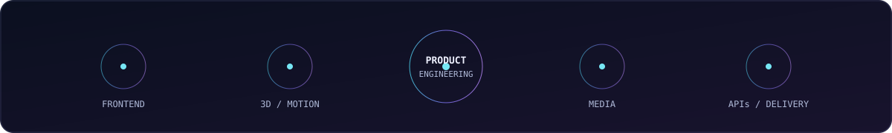

<div align="center">



**Frontend Software Engineer · React.js · Next.js · JavaScript**  
**1.5+ years of hands-on experience** · Madurai, India

[Portfolio](https://bhogyaan.vercel.app) · [LinkedIn](https://linkedin.com/in/bhogyaannr) · [Email](mailto:bhogyaannr@gmail.com) · [GitHub](https://github.com/Bhogyaan)

</div>

> Building interfaces that look simple. The engineering behind them isn't.

## `01 / THE DEVELOPER, IN ORBIT`

I’m **N R Bhogyaan**, a frontend engineer at **Zevotria**. I build product-focused web interfaces: reusable React systems, complex application workflows, responsive experiences, and interactive 3D and media tools. My work connects thoughtful UI with maintainable engineering—from API-backed application flows to browser-based creative tools.

Based in **Madurai, India**. Currently building with React and related tools, collaborating on product development, and helping other engineers ship. My recent work spans 3D previs and staging, commerce and administration tools, career workflows, and browser-based video editing.

> “It works on my machine. Now let’s make it work everywhere.”

## `02 / THE ENGINEERING CONSTELLATION`



**Product UI** · Responsive, cross-device interfaces · Reusable component systems · Custom SVG illustrations · Accessible, interaction-led experiences

**Application engineering** · React.js · Next.js · JavaScript (ES6+) · TypeScript · Redux / Redux Toolkit · REST API integration · State management · SaaS frontend architecture

**Motion & immersive UI** · GSAP · Framer Motion · Lenis · Three.js · React Three Fiber · Interactive 3D scenes and camera workflows

**Media & browser capabilities** · WebCodecs · Mediabunny · FFmpeg.wasm · Canvas · Web Audio · Browser extension development

**Build & delivery** · Node.js · Express · MongoDB · MySQL · Git workflows · Branching and merging · GitHub Actions · CI/CD · Vercel · Netlify · AWS

**Quality & reach** · Performance optimization · SEO · Responsive layouts · Cross-browser and cross-device engineering

> I list tools reflected in my profile and work—not a technology just because it’s popular this week.

## `03 / SELECTED PRODUCT WORLDS`

The products below are associated with my professional work at **Zevotria**. Product descriptions identify the products and their focus; they are not claims of sole ownership. Implementation and availability can vary by module. Public code and demos are omitted where they are not available to link.

| Product | Product focus | Engineering orbit |
| --- | --- | --- |
| **Kellygang.ai** | AI-powered creative platform, including a wedding studio experience. The existing profile describes a React Native / Expo app and VOWS Studio as a creative studio within it. | `React Native` · `Expo` · `modular UI` |
| **CareerPro AI** | Career development platform with resume editing, preview and export workflows, plus mock-interview experiences with response capture and speech transcription. | `React` · `JavaScript` · `application state` · `API integration` |
| **ETradeHub** | B2B marketplace product. | `Frontend product engineering` |
| **OYIL Luxe** | Premium shopping within the OYIL commerce ecosystem, alongside OYIL Attires and OYIL Admin CMS. The existing profile describes product, inventory, customer, order and rental management across that ecosystem. | `React` · `Vite` · `JavaScript` · `APIs` |

### Other engineering work

**3D Previs & Staging** — Interactive scene visualization and arrangement, including asset placement and transforms, camera controls, and animation/keyframe workflows. `React` · `Three.js` · `React Three Fiber` · `JavaScript`

**Browser-based video editor** — Interactive editing workflows and client-side media processing. Export controls and supported formats depend on the current implementation. `React` · `WebCodecs` · `Mediabunny` · `Canvas` · `Web Audio`

## `04 / EXPERIENCE`

**Associate Software Engineer · Zevotria**  
*July 2025–Present · Madurai*

Building frontend product experiences with React and related tools. The role includes collaborative product development and supporting other engineers.

**MERN Stack Developer Intern · MindVision Technologies**  
*January 2025–June 2025 · Madurai*

Built React pages and reusable UI components, connecting frontend features to backend APIs.

## `05 / CONTRIBUTION UNIVERSE`

A map of the tools and systems I work with—not a claim about contribution volume. The profile cards below are generated from GitHub account data by the existing repository workflows.

<div align="center">




</div>

## `06 / EDUCATION`

- **MCA**, K.L.N. College of Engineering · 2023–2025
- **B.Sc. Computer Science**, KLN Arts and Science College · 2019–2022

## `07 / DEBUG CONSOLE`

```text
BUG DETECTED
SUSPECT: undefined
LOCATION: somewhere between the state and the UI
STATUS: reproducing before changing production
```

The fun part is finding the actual cause—not adding another speculative fix. CSS isn’t broken; it just has a personality.

## `08 / LET’S BUILD SOMETHING`

Interested in frontend product engineering, interactive web applications, or 3D and media experiences? [Explore my portfolio](https://bhogyaan.vercel.app), [connect on LinkedIn](https://linkedin.com/in/bhogyaannr), or [send me an email](mailto:bhogyaannr@gmail.com).

<div align="center">

<sub>THE FRONTEND UNIVERSE · Professional engineer. Unprofessional bugs.</sub>

</div>
