<div align="center">



**Frontend Software Engineer · React.js · Next.js · JavaScript**  
**1.5+ years of hands-on experience** · Madurai, India

[Portfolio](https://bhogyaan.vercel.app) · [LinkedIn](https://linkedin.com/in/bhogyaannr) · [Email](mailto:bhogyaannr@gmail.com) · [GitHub](https://github.com/Bhogyaan)

</div>

> I build product-focused web interfaces: reusable React systems, complex application workflows, responsive experiences, and interactive 3D and media tools.

## `01 / IDENTITY CORE`

I’m **N R Bhogyaan**, a frontend engineer at **Zevotria**. My work sits at the intersection of product UI and engineering: turning detailed workflows into maintainable interfaces, connecting them to APIs and application state, and making interactive experiences feel responsive and clear.

My recent work includes 3D previs and staging, commerce and administration tools, career workflows, and browser-based video editing. The projects below are **company work developed at Zevotria**, not independently owned products. Descriptions focus on product scope and frontend areas; no company source code or private demonstrations are linked here.

## `02 / TECHNOLOGY ENGINE`

**Frontend**  
React · Next.js · JavaScript (ES6+) · TypeScript · HTML · CSS · Tailwind CSS · Redux Toolkit · Vite

**Interaction & 3D**  
GSAP · Three.js · React Three Fiber · interactive scene and camera workflows

**Media & APIs**  
WebCodecs · Mediabunny · FFmpeg.wasm · REST APIs · Axios

**Application & delivery**  
Node.js · Express · MongoDB · MySQL · Git · GitHub · GitHub Actions · CI/CD · Vercel

> Skills are intentionally limited to technologies reflected in my existing profile and the engineering work described here. I don’t list a technology just because it’s common in the stack.

## `03 / SELECTED PROFESSIONAL ENGINEERING WORK — ZEVOTRIA`

These are **Zevotria-associated products**. Product capabilities are described separately from individual ownership; implementation status can vary by module. Public code and demos are omitted where they are not authorized.

### 3D Previs & Staging · Flagship

An interactive 3D workflow for visualizing and arranging scenes. Frontend engineering scope includes scene interaction, asset placement and transforms, camera controls, animation/keyframe workflows, and real-time visualization.

`React` · `Three.js` · `React Three Fiber` · `JavaScript`

### OYIL · Multi-storefront commerce ecosystem

A connected company ecosystem: **OYIL Attires** for fashion rental and booking, **OYIL Luxe** for premium shopping, and **OYIL Admin CMS** for managing products, inventory, customers, orders, rentals, shipping, returns, and billing workflows. My work is within the frontend product experience, across storefront and operational workflows.

`React` · `Vite` · `JavaScript` · `APIs`

### CareerPro AI · Career platform

Frontend workflows for resume editing, preview and export, alongside mock-interview experiences with response capture and speech transcription. AI-assisted feedback is presented as a platform capability, not as my ownership of its underlying models or services.

`React` · `JavaScript` · `application state` · `API integration`

### Browser-based video editor · Media engineering

A browser video-editing and export experience. The engineering challenge spans interactive editing workflows and client-side media processing; export controls and supported formats depend on the current implementation.

`React` · `WebCodecs` · `Mediabunny` · `Canvas` · `Web Audio`

### Kellygang.ai · Creative mobile application

A React Native and Expo application with a modular creative experience, navigation, and reusable UI. **VOWS Studio** is presented as a creative studio within this parent application; prototype and development-stage modules should not be read as completed features.

`React Native` · `Expo`

### VOWS · Creative wedding studio within Kellygang.ai

A modular concept for organizing wedding production workflows, including project planning, couple and venue concepts, decor, invitations, storyboards, photography, cinematic video, and editing. Module availability varies; 3D staging and visualization are included only where implemented.

`React Native` · `Expo` · `modular UI` · `3D workflows where implemented`

## `04 / PROFESSIONAL EXPERIENCE`

**Associate Software Engineer · Zevotria**  
*July 2025–Present · Madurai*

Building frontend product experiences with React and related tools. The role includes collaborative product development and supporting other engineers. A previous profile draft mentioned a 4× page-load improvement and mentoring four interns; I’ve left those specific claims out until their scope and evidence can be confirmed.

**MERN Stack Developer Intern · MindVision Technologies**  
*January 2025–June 2025 · Madurai*

Built React pages and reusable UI components, connecting frontend features to backend APIs. This internship is listed separately from professional employment.

## `05 / ENGINEERING INVESTIGATION UNIT`

```text
BUG DETECTED
SUSPECT: undefined
LOCATION: somewhere between the state and the UI
STATUS: reproducing before changing production
```

The fun part is finding the actual cause—not adding another speculative fix.

## `06 / CONTRIBUTION UNIVERSE`

A small map of the tools and systems I work with—not a claim about contribution volume. GitHub activity and language cards below are generated from account data by the existing profile workflows.

<div align="center">




</div>

## `07 / EDUCATION`

- **MCA**, K.L.N. College of Engineering · 2023–2025
- **B.Sc. Computer Science**, KLN Arts and Science College · 2019–2022

CGPAs are omitted for now: the existing profile and supplied details disagree, and I don’t have a current resume attached here to resolve them.

## `08 / CONNECTION PORTAL`

Interested in frontend product engineering, interactive web applications, or 3D and media experiences? [Explore my portfolio](https://bhogyaan.vercel.app), [connect on LinkedIn](https://linkedin.com/in/bhogyaannr), or [email me](mailto:bhogyaannr@gmail.com).

<div align="center">

<sub>BHOGYAAN OS · Professional engineer. Unprofessional bugs.</sub>

</div>
