<picture>
  <source media="(prefers-color-scheme: light)" srcset="https://raw.githubusercontent.com/Bhogyaan/Bhogyaan/main/assets/hero-animated.svg">
  
</picture>

📍 Madurai, India · **Frontend Engineer** · 1.5+ years building for the web

---

## ✦ About me

I’m **N R Bhogyaan**, a frontend engineer who enjoys making digital products feel as good as they work. I care about crisp responsive UI, thoughtful motion, accessibility, and performance—from the first interaction to the last pixel.

**Currently:** Associate Software Engineer at Zevotria, building React products and guiding a team of four. I’ve helped improve page-load time by up to **4×**.

## ✦ My toolkit

**Languages**  
 

**Frameworks**  
   

**Styling & motion**  
   

**Tools & creative tech**  
   

<strong>More in my toolkit</strong>

Redux Toolkit · React Three Fiber · Web Audio · Mediabunny · FFmpeg.wasm · Web Workers · Express · REST APIs · MongoDB · MySQL · GitHub Actions · AWS · Vercel · Netlify

## ✦ Selected work

A few kinds of products I’ve enjoyed building. Visit my [portfolio](https://bhogyaan.vercel.app) for project details and demos, or [browse my repositories](https://github.com/Bhogyaan?tab=repositories) for available source code.

| Project | The experience | Built with |
|:--|:--|:--|
| **Browser video editor** | Timeline editing, effects, and audio controls with local exports up to 4K—media stays on your device. | React · WebCodecs · Mediabunny · Canvas · Web Audio |
| **3D previs & staging** | Interactive camera-rig simulation, focal-length/FOV calculations, vector keyframing, and transform gizmos. | Three.js · React Three Fiber |
| **E-commerce & rental platform** | Shopping and booking flows with admin tools for products, listings, orders, and bookings. | React · Redux · Tailwind CSS |
| **Childcare website + CMS** | A content, asset, and events manager designed for non-technical staff. | React · Node.js · Express · MongoDB |

## ✦ A little career context

**Associate Software Engineer · Zevotria** · *Madurai · Jul 2025–Present*  
Building React/Redux product features, responsive GSAP interfaces, shared components, and a Chrome extension. Improved page-load time by up to **4×**; I also guide a team of four and support CI/CD and deployments.

**MERN Stack Developer Intern · MindVision Technologies** · *Jan 2025–Jun 2025*  
Built React pages and reusable UI components, connecting frontend features to backend APIs.

<strong>Education & extras</strong>

- **MCA**, K.L.N. College of Engineering — 2025 · CGPA 8.3
- **B.Sc. Computer Science**, KLN Arts and Science College — 2022 · CGPA 7.9
- **Certification:** Web Development (Udemy); workshops in React.js, Power BI, and MERN Stack
- **Languages:** English · Tamil

## ✦ GitHub, in motion

<picture>
  <source media="(prefers-color-scheme: dark)" srcset="https://github-readme-stats.vercel.app/api?username=Bhogyaan&show_icons=true&hide_border=true&bg_color=171326&title_color=B7F36B&text_color=D7CFEA&icon_color=FF7A90">
  
</picture>
<picture>
  <source media="(prefers-color-scheme: dark)" srcset="https://github-readme-stats.vercel.app/api/top-langs/?username=Bhogyaan&layout=compact&hide_border=true&bg_color=171326&title_color=B7F36B&text_color=D7CFEA">
  
</picture>

<picture>
  <source media="(prefers-color-scheme: dark)" srcset="https://streak-stats.demolab.com?user=Bhogyaan&hide_border=true&background=171326&ring=B7F36B&fire=FF7A90&currStreakLabel=B7F36B&sideLabels=D7CFEA&currStreakNum=FFFFFF&sideNums=FFFFFF&dates=9A91AE">
  
</picture>

**Currently building:** polished interfaces, useful motion, and faster experiences. ▰▰▰▰▰▰▰▱▱▱

[Portfolio ↗](https://bhogyaan.vercel.app) · [LinkedIn ↗](https://linkedin.com/in/bhogyaannr) · [Email me ↗](mailto:bhogyaannr@gmail.com) · [All repositories ↗](https://github.com/Bhogyaan?tab=repositories)

